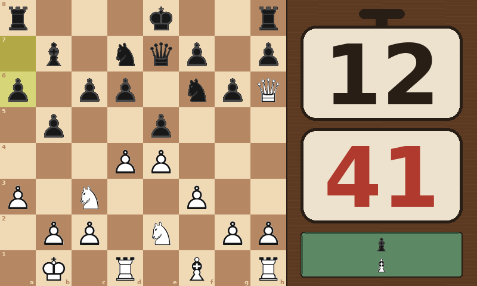

# Lichee Pi Nano display apps

Full-screen apps for a tiny [Lichee Pi Nano](https://wiki.sipeed.com/soft/Lichee/zh/Nano-Doc-Backup/get_started/first_eye.html)
(Allwinner F1C100s: a 400 MHz ARM9, 32 MB of RAM) and a 5" 800x480 touch screen, on a minimal Linux
built with [Buildroot](https://buildroot.org). Every app is self-contained (its screens, art,
settings and background fetcher), can be signed and installed on its own, and is switched on the
touchscreen (Settings > Apps):

* **[A chess clock](apps/chess/README.md)**: a chessboard replaying famous games beside a walnut chess-clock
  case that keeps the time.
* **Countdowns to a trip**: the days left on flip-clock cards over a living picture of where you're
  going, changing with the time of day ([countdown apps](docs/countdown.md), on a shared
  [runtime](apps/countdown/README.md)): **a Disney cruise** (the ship at sea, a fleet map with live AIS
  positions) and **Magic Kingdom** (Cinderella Castle, live ride wait times).



The SD card holds a base system and, on a partition of their own, the apps: changing an app never
means rebuilding the image. WiFi comes from an ESP32 on the SPI bus ([wifi](docs/wifi.md)), and a
custom board with the 64 MB F1C200s is designed in [hardware/protoboard](hardware/protoboard).

## Hardware

| Part | Notes |
|---|---|
| [Lichee Pi Nano](https://wiki.sipeed.com/soft/Lichee/zh/Nano-Doc-Backup/get_started/first_eye.html) | Allwinner F1C100s, 32 MB RAM, boots from microSD |
| 5" 800x480 40-pin RGB TFT with 4-wire resistive touch | e.g. the F50GLQ24E22. Its ribbon plugs straight into the Nano; the touch film's 4-wire tail goes to the ribbon's last four pins, which the Nano routes to its on-board touch chip |
| microSD card | any size; the image is about 200 MB |
| 5 V USB power supply and micro-USB cable | the micro-USB port is also the development tools' fast serial line, when plugged into a computer |
| *Optional:* the [3D-printed enclosure](hardware/enclosure) | picture frame, back cover and desk cradle |
| *Optional:* an ESP32 | for WiFi ([wifi](docs/wifi.md)) |
| *Optional:* a 3.3 V USB-serial adapter | the console on the Nano's UART0, 115200 baud (login `root` / `root`) |

The board has no battery-backed clock: the countdown apps keep the time on the SD card across
power cuts (the chess clock asks for it again), and with WiFi it's set from the network.

## Quick start

```sh
# once: the base image (1-2 hours), then
tools/build/build.sh [--app castle] [--wifi]     # -> build/images/ (build/images-wifi/)
tools/board/flash_sd.sh --all build/images       # the SD card (macOS; asks first)
tools/board/deploy.py castle                     # afterwards: apps go over USB, no reflashing
tools/preview/preview.py castle                  # or try them on the Mac first, in a window
```

[Building and flashing](docs/building.md) has the base image, Docker, and disk space.

## Documentation

| | |
|---|---|
| [docs/building.md](docs/building.md) | building the image, flashing the card, disk space |
| [docs/apps.md](docs/apps.md) | what an app is: how it's laid out, started, switched, deployed, signed and installed |
| [docs/countdown.md](docs/countdown.md) | the countdown apps: their app.json, scenes, the cruise and the castle |
| [docs/system.md](docs/system.md) | how the system works: kernel, device tree, boot, memory |
| [docs/wifi.md](docs/wifi.md) | WiFi through an ESP32: building, wiring, and what it took to make it work |
| [docs/tools.md](docs/tools.md) | the development tools: talking to the board, checking changes |
| [apps/chess/README.md](apps/chess/README.md), [apps/countdown/README.md](apps/countdown/README.md) | the chess clock, and the countdown runtime |
| [tools/themegen/README.md](tools/themegen/README.md) | making the countdown's artwork |
| [hardware/](hardware) | the enclosure, and the protoboard (KiCad) |

## Repository layout

| Path | |
|---|---|
| `board/licheepi_nano/`, `configs/`, `package/` | the Buildroot `BR2_EXTERNAL` tree: kernel config, patches and device tree, U-Boot, the SD card layout, the root filesystem overlay (the app launcher), WiFi's package (Buildroot itself is unmodified) |
| `apps/` | the apps, one folder each (`app.json`, `run`): `chess`, `castle`, `cruise`, and `countdown` (the runtime the countdowns run on) |
| `tools/board/` | talking to the board over serial: deploy, push, run, flash the card |
| `tools/build/` | incremental builds in a container |
| `tools/preview/` | the apps live on the Mac, in a window of their own, the mouse as the touchscreen |
| `tools/test/` | checks, including pixel-for-pixel renders of the countdown |
| `tools/apps/` | laying out, packing and signing an app; the signing key |
| `tools/themegen/` | the countdown's artwork: scenes, map, Settings text |
| `tools/wifi/` | the ESP32's firmware |
| `hardware/` | the enclosure and the protoboard |
| `docs/` | the documentation above |
| `Dockerfile.base`, `Dockerfile` | the base image, and a one-shot build (for Docker) |
| `assets/` | (not in the repository) source photos, models and fonts for the artwork |

## Credits

The Buildroot setup started from [unframework/licheepi-nano-buildroot](https://github.com/unframework/licheepi-nano-buildroot), which in turn adapted the FunKey Zero project's [buildroot-licheepi-zero](https://github.com/Squonk42/buildroot-licheepi-zero/). The F1C100s kernel and U-Boot work comes from @Icenowy, @Lichee-Pi and @unframework. The famous games are public-domain chess history.

Licensed under the GPL-3.0 (see [LICENSE](LICENSE)).
