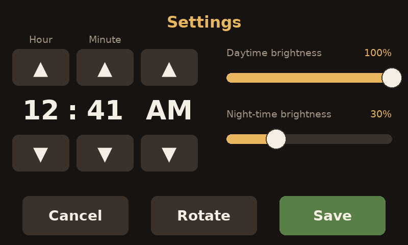

# Chess Clock

A desk clock for chess-loving kids, built on a tiny [Lichee Pi Nano](https://wiki.sipeed.com/soft/Lichee/zh/Nano-Doc-Backup/get_started/first_eye.html) and a 5" touch screen.


A chessboard quietly replays famous games - the Opera Game, the Immortal Game, Fischer's Game of the Century and more - one sliding move every few seconds. Beside it, a walnut chess-clock case shows the time on two clock faces, with the pieces each side has lost collecting in a felt tray.

* Each game opens with a caption naming it, its year and its players. Captured pieces arc off the board into the tray, and when a game ends in checkmate the beaten king topples over.
* Every minute, the clock's plunger dips and the minute face flips over like a split-flap display.
* On the hour, a pawn marches up the hour face and promotes into the new hour.
* Press and hold the screen for two seconds - the clock's plunger sinks as you hold - to open **Settings** (so a passing tap can't change anything; a quick tap shows the game's name instead): set the time, choose daytime and night-time brightness (night runs 9 PM to 7 AM, with a gentle fade between them), or turn the display upside down.



Everything runs on a single-core 400MHz ARM9 with 32MB of RAM: a minimal Linux built with [Buildroot](https://buildroot.org), and the clock written in Python, drawing straight to the screen with no desktop or windowing system.

## Hardware

| Part | Notes |
|---|---|
| [Lichee Pi Nano](https://wiki.sipeed.com/soft/Lichee/zh/Nano-Doc-Backup/get_started/first_eye.html) | Allwinner F1C100s, 32MB RAM, boots from microSD |
| 5" 800x480 40-pin RGB TFT with 4-wire resistive touch | e.g. the F50GLQ24E22. Its ribbon plugs straight into the Nano; the touch film's 4-wire tail goes to the ribbon's last four pins, which the Nano routes to its on-board touch chip |
| microSD card | any size; the image is about 75MB |
| 5V USB power supply and micro-USB cable | a right-angle plug fits the enclosure best |
| *Optional:* the [3D-printed enclosure](enclosure) | picture frame, back cover and desk cradle; 4x M3 x 6mm self-tapping screws and some thin foam |
| *Optional:* a 3.3V USB-serial adapter | for the console, on the Nano's UART0 at 115200 baud (login `root` / `root`) |

**One limitation:** the Nano has no battery-backed clock, so the time resets at every power cut and has to be set again from Settings. A DS3231 real-time clock module on the touch chip's I2C bus would fix this.

## Getting Started

1. **Build the SD card image** (see [Building](#building) below), which produces `dist/sdcard.img`.
2. **Write it to a microSD card.** On macOS, find the card with `diskutil list` (say it's `/dev/disk4` - double-check, `dd` overwrites whatever disk it's given):

   ```sh
   diskutil unmountDisk /dev/disk4
   sudo dd if=dist/sdcard.img of=/dev/rdisk4 bs=4m status=progress
   diskutil eject /dev/disk4
   ```

   If macOS then says the disk isn't readable, click **Ignore**. On Linux, `dd` to `/dev/sdX`; on Windows, use Balena Etcher.
3. **Boot it.** A chess knight splash appears within a few seconds, then the clock.
4. **Set the time:** press and hold the screen until Settings opens (two seconds), use the arrows, and press **Save**. Adjust the brightness sliders there too.

Settings are kept on the SD card, so they survive power cuts (the time itself doesn't; see above). Reflashing the card resets them.

## Building

Builds run in containers - Apple's [`container`](https://github.com/apple/container) tool on macOS, or Docker 23+. There are two steps: a slow one-off **base image** (the cross-compiler and a complete first build, 1-2 hours), then a **fast build** on top of it that copies in your current files and rebuilds what changed (a few minutes).

### On macOS with Apple's `container`

```sh
# once: the base image, built natively for Apple silicon
container build --memory 4g --cpus 8 -f Dockerfile.base --target main -t licheepi-nano-mybase:latest .

# each time: the fast build, unpacked into dist/
container build --memory 4g --cpus 8 --build-arg BASE_IMAGE=licheepi-nano-mybase \
    -o type=tar,dest=dist.tar . \
  && mkdir -p dist && tar -xf dist.tar -C dist --strip-components=1 && rm dist.tar
```

`container` can't send the build output to the terminal (`dest=-` writes a file literally named `-`), hence the tar file. The upstream project's published base image on Docker Hub is amd64-only and predates this project, so build your own.

### With Docker

```sh
docker build -f Dockerfile.base --target main -t licheepi-nano-mybase:latest .
docker build --build-arg BASE_IMAGE=licheepi-nano-mybase --output type=tar,dest=- . | (mkdir -p dist && tar x -C dist)
```

### What the fast build rebuilds

It copies `board/`, `configs/`, `package/` and `clock/` into the base image and runs Buildroot again, always rebuilding the kernel (so kernel config and patch changes take effect), the clock, U-Boot and the boot script. Other changes don't always trigger a rebuild in Buildroot - see its manual on [when a full rebuild is necessary](https://buildroot.org/downloads/manual/manual.html#full-rebuild) - so when in doubt, rebuild the base image. To look around inside the build (or run `make menuconfig`): `container run -it licheepi-nano-mybase /bin/bash`.

## Repository Layout

| Path | |
|---|---|
| [`clock/`](clock) | the clock application, with [its own README](clock/README.md): settings, logs, touch calibration, trying it on a desktop |
| [`enclosure/`](enclosure) | the 3D-printable enclosure, with [its own README](enclosure/README.md): parts, printing, assembly |
| [`package/fbclock/`](package/fbclock) | the Buildroot package that installs the clock |
| [`configs/licheepi_nano_defconfig`](configs/licheepi_nano_defconfig) | the Buildroot configuration: packages, kernel, U-Boot, SD card image |
| [`board/licheepi_nano/linux/`](board/licheepi_nano/linux) | kernel config, device tree and display patch |
| [`board/licheepi_nano/`](board/licheepi_nano) | boot script, SD card layout, and a root filesystem overlay for small system tweaks |
| `Dockerfile.base`, `Dockerfile` | the base image and fast build |
| [`tools/`](tools) | development tools: talk to the board over serial, time its boot, simulate the clock on a desktop, check the games (see [below](#development-tools)) |
| [`docs/`](docs) | screenshots |

The Buildroot customisation is a `BR2_EXTERNAL` extension, so Buildroot itself is used unmodified.

## How It Works

**Software.** The clock is one Python program using Pillow to draw directly into the Linux framebuffer, installed pre-compiled and caching its drawings on the SD card so it starts in about 5 seconds. With only about 26MB of RAM available to programs, it never holds a whole screen as an image: the board's squares and the parts of the clock case are drawn and written separately, piece slides redraw only the area the piece moves through, and the minute flip and hour promotion are prepared in advance and played back as small changed strips. It restarts itself if anything goes wrong, and logs to the SD card. More in [clock/README.md](clock/README.md).

**Kernel.** Mainline Linux 6.18 LTS. Mainline supports most of the F1C100s - SD card, DMA, I2C, PWM, watchdog, audio - but not its display, so [one small patch](board/licheepi_nano/linux/patches) adds that, carried over from the [5.11 kernel fork](https://github.com/unframework/linux/commits/nano-5.11) this project started on. The kernel config is cut down to what the clock uses (no networking, USB, loadable modules or text console, compiled for size), which leaves several megabytes more RAM than the old kernel did.

**Device tree.** The [custom device tree](board/licheepi_nano/linux/suniv-f1c100s-licheepi-nano-custom.dts) builds on mainline's Lichee Pi Nano file and adds:

* the display pipeline and the 800x480 panel;
* a dimmable backlight - the backlight driver's enable pin (PE6) driven by PWM at 500Hz;
* the I2C bus to the Nano's on-board NS2009 resistive-touch chip (PE11/PE12), with the pins' internal pull-ups enabled, since the board has none and the bus doesn't work without them.

**Boot.** U-Boot is [a v2021.01 fork](https://github.com/unframework/u-boot/commits/2021.01-f1c100s) with F1C100s support, set up ([`uboot.fragment`](board/licheepi_nano/uboot.fragment)) to boot without its usual 2-second countdown or a USB scan; holding a key on the serial console while powering on still stops at its prompt. The kernel is LZ4-compressed, which unpacks faster than gzip on this CPU, and boots `quiet` so it doesn't spend time printing every message over the serial line. The screen shows nothing until the first startup script puts up the splash image, ready-made in the screen's own pixel format; that script uses only shell built-ins, as starting other programs is slow on this CPU.

## Development Tools

The [`tools/`](tools) folder holds what this project was developed with (`pip install -r tools/requirements.txt` for pyserial and Pillow). The board ones use a USB-serial adapter on the Nano's UART0; set `CLOCK_SERIAL` if yours isn't `/dev/cu.usbserial-0001`.

| Tool | |
|---|---|
| `run_on_board.py "COMMAND" ...` | run shell commands on the board and print the output (logs in as root first if needed) |
| `push_to_board.py LOCAL REMOTE` | copy a file to the board over serial (~10KB/s), checksum-verified - e.g. a changed `clock/fbclock.py` to `/usr/lib/python3.11/site-packages/`, then restart the clock, to try a change without reflashing |
| `boot_time.py [--bench URL DEVICE CH]` | time a boot from power-on, stage by stage; `--bench` switches the power through a lab-bench server's API, otherwise you power-cycle it yourself |
| `simulate.py FONT_DIR [OUT_DIR]` | run the clock's animations and touch handling on a desktop against an in-memory screen, save frames as PNGs, and check the results |
| `check_games.py [PGN]` | check every game in `clock/games.pgn` replays correctly - run it after adding a game |

## Credits

The Buildroot setup started from [unframework/licheepi-nano-buildroot](https://github.com/unframework/licheepi-nano-buildroot), which in turn adapted the FunKey Zero project's [buildroot-licheepi-zero](https://github.com/Squonk42/buildroot-licheepi-zero/). The F1C100s kernel and U-Boot work comes from @Icenowy, @Lichee-Pi and @unframework. The famous games are public-domain chess history.

Licensed under the GPL-3.0 (see [LICENSE](LICENSE)).
