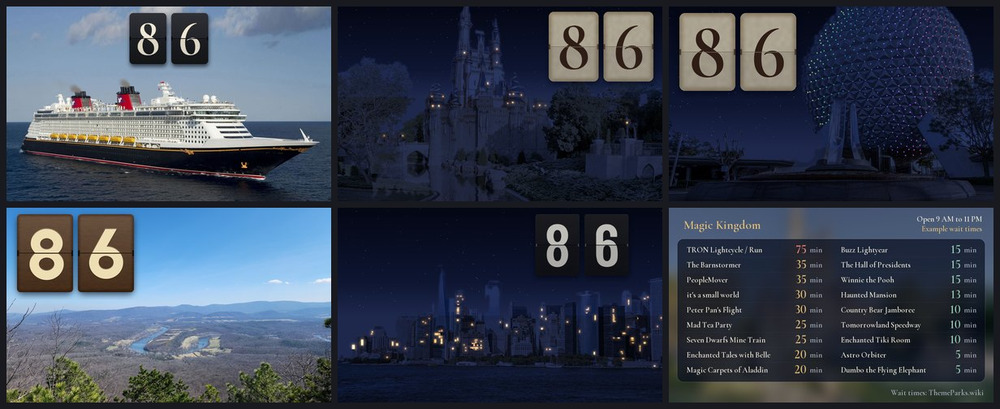

# Trip countdown frame

A little touchscreen picture frame that counts down to your next trip: the days left on flip-clock
cards over a living picture of where you're going. The scene follows the time of day (dawn, noon,
dusk, night), with lights coming on in its windows, water rippling, smoke rising, mist in the valley,
birds and fireflies, fireworks after dark, and between them the trip's own screens: live ride wait
times, the weather there, where your ship is. It runs on a [Lichee Pi Nano](https://wiki.sipeed.com/soft/Lichee/zh/Nano-Doc-Backup/get_started/first_eye.html)
(a tiny Allwinner F1C100s board: an ARM9, 32 MB of RAM) with a 5" 800x480 touch screen.

And a **scene editor** on the Mac to make your own: drop in a photo of where you're going, and the
**Scene Builder** makes its dusk and night, finds the sky, the water and the windows, and lets you add
lights, effects and screens, watching the result live in a preview window, then install it on the
frame over USB.



## On the frame

* **The countdown:** days to go on flip-clock cards (parchment, black split-flap, wood, a departure
  board), the hours and minutes on the last day, and the trip's own greeting once you're there ("Bon
  voyage!", "Have a magical day!").
* **A living scene**, blended from day, dusk and night pictures by the real time, with effects drawn in
  C fast enough for the little ARM9: window lights that switch on and off, lights on a sphere playing
  light shows, water, foam, smoke, mist, birds, fireflies, fireworks and a nightly show.
* **Screens in turn** with the countdown: a park's live ride waits ([ThemeParks.wiki](https://themeparks.wiki)),
  a 10-day forecast with rain and snow ([Open-Meteo](https://open-meteo.com)), a map of the Disney ships
  placed by their itineraries.
* **Touch settings:** the trip's date, fireworks, which rides, display brightness by day and night,
  WiFi, and switching between trips (or to the [chess clock](apps/chess/README.md) that started it all).
* **Signed apps:** each trip is an app, signed with your key; the frame can be locked to signed apps
  (developer mode off), and can install them from your own catalog over WiFi.

The apps here: **a Disney cruise**, **Magic Kingdom**, **EPCOT**, **Universal**, **a backpacking trip**,
**New York City**, and **the chess clock**.

## On the Mac: preview and Scene Builder

```sh
tools/setup.sh                       # once: Python (uv), the fonts; --ai for "find automatically"
tools/preview/preview.py castle      # the app running in a window, the mouse as the touchscreen
```

The preview runs the real app with the device's own drawing code. Its **Controls** set the time of
day, fire the fireworks, birds or fireflies, and (**Remote**) do the same on the frame over USB. Its
**Scene Builder** panel, docked beside it:

* **New…** a trip (a name, a park's ride waits, a place's weather), or pick an existing one;
* **Photos:** drop a photo to try it as the scene (each a trial, kept in the app when you like it);
  zoomed in, you paint on the original photo at full resolution;
* **Layout:** where the countdown sits, its size, the card style, the horizon;
* **Effects:** lights on a sphere and their shows; window lights (painted, boxed, found, with frames
  kept dark in front and windows grouped to switch together); water and foam; smoke, mist and birds;
  fireworks and fireflies;
* **Screens:** ride waits, weather (place checked), the ship map, and for how long each shows;
* **On the device:** install it on the frame, signed or not.

Every change is saved as you go. More in [the tools](docs/tools.md).

## Hardware

| Part | Notes |
|---|---|
| [Lichee Pi Nano](https://wiki.sipeed.com/soft/Lichee/zh/Nano-Doc-Backup/get_started/first_eye.html) | Allwinner F1C100s, 32 MB RAM, boots from microSD; run at 600 MHz (its own 408: `CPU_MHZ` in the device's settings) |
| 5" 800x480 40-pin RGB TFT with 4-wire resistive touch | e.g. the F50GLQ24E22: its ribbon plugs straight into the Nano, the touch film's tail to the ribbon's last four pins |
| microSD card | any size; the image is about 200 MB |
| 5 V USB power and a micro-USB cable | the micro-USB port is also the tools' fast serial line to the Mac |
| *Optional:* an ESP32 | WiFi, on the SPI bus ([wifi](docs/wifi.md)), for live waits, weather, ship positions, the catalog and the clock |
| *Optional:* a PAM8403 amplifier and a speaker | sound, from the chip's own audio codec ([system](docs/system.md)) |
| *Optional:* the [3D-printed enclosure](hardware/enclosure) | picture frame, back cover and desk cradle |
| *Optional:* a 3.3 V USB-serial adapter | the console on UART0, 115200 baud |

A custom board with the 64 MB F1C200s, the ESP32, the amplifier and room to tinker is designed in
[hardware/protoboard](hardware/protoboard). The board has no battery-backed clock: the frame keeps the
time on the SD card across power cuts, and sets it from the network with WiFi.

## Building and flashing

```sh
tools/build/build.sh --wifi                      # the base system (the first time: 1-2 hours)
tools/board/flash_sd.sh --all build/images-wifi  # the SD card (macOS; asks first)
tools/board/deploy.py --signed system countdown castle   # then apps go over USB: no reflashing
```

The SD card holds a read-only base system and, on a partition of their own, the apps and their
settings: changing an app never means rebuilding the image, and reflashing the base keeps the apps.
[Building and flashing](docs/building.md) has the details. `tools/test/check.py` checks everything,
rendering every scene and comparing it pixel for pixel with the last time.

## Documentation

| | |
|---|---|
| [docs/countdown.md](docs/countdown.md) | the countdown apps: their scenes, effects, screens and settings |
| [docs/tools.md](docs/tools.md) | the Mac tools: setup, the preview and Scene Builder, deploying, checking |
| [docs/apps.md](docs/apps.md) | what an app is: laid out, started, switched, signed, installed, the catalog, developer mode |
| [docs/system.md](docs/system.md) | how the system works: kernel, device tree, boot, memory, sound, security |
| [docs/wifi.md](docs/wifi.md) | WiFi through an ESP32: wiring, firmware, the wiring check and wiring test |
| [docs/building.md](docs/building.md) | building the base system and flashing the card |
| [apps/countdown/README.md](apps/countdown/README.md), [apps/chess/README.md](apps/chess/README.md) | the countdown runtime, and the chess clock |
| [tools/themegen/README.md](tools/themegen/README.md) | how scenes are made and packed |
| [hardware/](hardware) | the enclosure, and the protoboard (KiCad) |

## Repository layout

| Path | |
|---|---|
| `apps/` | one folder per app (`app.json`, `run`, its scene): `cruise`, `castle`, `epcot`, `universal`, `backpacking`, `new-york-city`, `chess`; `countdown` (the runtime the trips share: the countdown, its screens and their fetchers) and `system` (what every app shares: the C drawing library, Settings, Device settings, WiFi, the picker) |
| `tools/preview/` | the preview window (Swift), the Scene Builder (a web page in it), and the server between them |
| `tools/themegen/` | making scenes from photos (`photo_scene.py`), packing them (`scene_pack.py`), icons, splashes, the ship map |
| `tools/apps/` | new apps, packing and signing them, publishing the catalog |
| `tools/board/` | talking to the board over USB: deploy, run, flash the card |
| `tools/build/` | incremental base-system builds in a container |
| `tools/wifi/` | the ESP32's WiFi firmware, and its wiring-test firmware |
| `tools/test/` | the checks |
| `board/licheepi_nano/`, `configs/`, `package/` | the Buildroot `BR2_EXTERNAL` tree: kernel config, patches and device tree, U-Boot, the SD card layout, the boot scripts (Buildroot itself is unmodified) |
| `hardware/` | the enclosure and the protoboard |
| `docs/` | the documentation above |
| `pyproject.toml`, `uv.lock`, `.python-version` | the Mac tools' Python (`tools/setup.sh`) |
| `Dockerfile.base`, `Dockerfile` | the base image, and a one-shot build |
| `assets/` | (not in the repository) source photos and fonts |

## Credits

The Buildroot setup started from [unframework/licheepi-nano-buildroot](https://github.com/unframework/licheepi-nano-buildroot), which in turn adapted the FunKey Zero project's [buildroot-licheepi-zero](https://github.com/Squonk42/buildroot-licheepi-zero/). The F1C100s kernel and U-Boot work comes from @Icenowy, @Lichee-Pi and @unframework. Ride waits from [ThemeParks.wiki](https://themeparks.wiki), weather from [Open-Meteo](https://open-meteo.com), ship schedules from [CruiseMapper](https://www.cruisemapper.com). The scenes made from photos of Disney and Universal parks and ships are for personal use; Disney and Universal names and places are their owners' trademarks. The famous chess games are public-domain chess history.

Licensed under the GPL-3.0 (see [LICENSE](LICENSE)).
